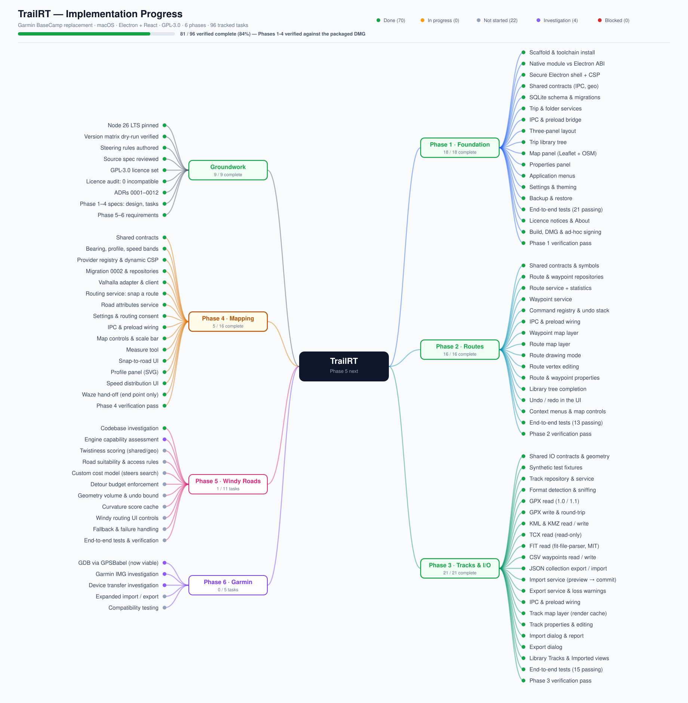

# TrailRT

A modern desktop replacement for Garmin BaseCamp. Local-first, macOS, built on
Electron with React and TypeScript. Plan, organise, view and edit outdoor trips,
routes, tracks and waypoints, with OpenStreetMap as the initial map provider and
no Garmin hardware or cloud account required.

**Status: Phases 1 and 2 complete and verified.** The app launches, renders an
OpenStreetMap map, and manages trips, folders, routes and waypoints that persist
across restarts. Routes are drawn and edited directly on the map, with undo and
redo over every edit. Phase 3 (tracks and import/export) is next.

Every acceptance criterion for both phases is verified against the packaged DMG
build, not just the development output: 215 unit tests and 34 end-to-end tests
pass, with a clean typecheck and no lint errors.

```sh
nvm use          # Node 26
npm install
npm run dev      # development, with HMR
npm run verify   # lint, typecheck, unit tests, build, end-to-end tests
npm run package  # macOS .app + DMG for arm64 and x64
```



## Where things are

| Path                                                     | Contents                                                           |
| -------------------------------------------------------- | ------------------------------------------------------------------ |
| [`.kiro/specs/`](.kiro/specs/)                           | Phase specs, and the review of the source specification            |
| [`.kiro/steering/`](.kiro/steering/)                     | Always-applied rules: toolchain, architecture, licensing, progress |
| [`docs/adr/`](docs/adr/)                                 | Architectural decision records                                     |
| [`docs/licences/`](docs/licences/)                       | Third-party dependency and licence register                        |
| [`docs/progress-mindmap.svg`](docs/progress-mindmap.svg) | Canonical implementation status                                    |

Read [`.kiro/specs/spec-review.md`](.kiro/specs/spec-review.md) first. It
records the contradictions found in the source specification and how each was
resolved, plus the two open questions that still need an owner decision.

## Toolchain

Node 26 LTS, pinned in `.nvmrc`. Run `nvm use` before any npm command. The
verified version matrix for the whole stack lives in
[`.kiro/steering/toolchain.md`](.kiro/steering/toolchain.md); every entry was
resolved against the registry and dry-run installed together, so it is a known
good set rather than an aspiration.

## Development phases

1. **Foundation** — _complete._ Electron shell, security baseline, SQLite with
   migrations, three-panel layout, trip library, OpenStreetMap view, menus,
   settings, backup and restore
2. **Routes and waypoints** — _complete._ Draw routes on the map, drag/insert/
   delete vertices, waypoints with a Garmin-aligned symbol set, derived
   statistics, and an undo history over every edit
3. **Tracks and import/export** — GPX, KML/KMZ, TCX, FIT, CSV, JSON, with an
   import report that never silently discards data
4. **Advanced mapping** — additional providers, routing abstraction, elevation
   profiles
5. **Garmin compatibility** — GDB, IMG and device transfer investigations

Phases are built in order. Later phases are specified at requirements level only
until the phase before them is built and tested.

## Licence

**GPL-3.0-or-later.** See [`LICENSE`](LICENSE).

TrailRT is free to download and use. No subscriptions, no mandatory accounts, no
advertising, no paid feature tiers, and no cloud dependency for core
functionality. It is meant to be a community-friendly alternative to BaseCamp,
and the licence is chosen to keep it that way.

Every dependency is audited for GPL-3.0 compatibility before it is added, and
the results are recorded in
[`docs/licences/third-party-register.md`](docs/licences/third-party-register.md).
The current audit covers 369 packages with no incompatibilities. Two packages
were excluded on licence grounds: `react-leaflet` (Hippocratic-2.1, so Leaflet
is used directly) and Garmin's own `@garmin/fitsdk` (proprietary EULA, so the
MIT-licensed FIT parser is used instead).

Distribution is via GitHub releases and a DMG. The Mac App Store is not a
target — its terms conflict with GPL-3.0.

## Installing a release build

There is no Apple Developer ID for this project yet, so release builds are
ad-hoc signed rather than notarised. macOS will block the app on first launch
with a message about being unable to check it for malicious software.

To open it:

1. Try to open TrailRT once, so macOS records the block.
2. Open **System Settings → Privacy & Security**, scroll to the Security
   section, find the line naming TrailRT, and click **Open Anyway**.
3. Authenticate. The app opens normally from then on.

The old Control-click → Open shortcut no longer works; macOS removed it in
Sequoia. Do not disable Gatekeeper system-wide to work around this — that trades
your whole machine's protection for one app.

Building from source avoids the prompt entirely, since locally built bundles are
not quarantined. Notarisation is already configured in the build and will be
switched on if a Developer ID becomes available. See
[ADR 0009](docs/adr/0009-unsigned-distribution-until-developer-id.md).

## Known limitations

Recorded up front rather than discovered later:

- **GDB** has no JavaScript parser. GPSBabel is the only mature reader, and
  because it is GPL-2.0-or-later it is compatible with our licence, so support
  is viable — but it is Phase 5 work and unproven until tested against real
  files. See ADR 0006 as amended.
- **Garmin IMG** rendering is architecturally accommodated but not planned for
  implementation. No encryption or licensing circumvention, ever.
- **Waze** accepts a single destination per link, so route hand-off resolves to
  the end point. Multi-stop is not supported by the platform — see ADR 0005.
- **Elevation** is shown only where the source data carries it. Nothing is
  synthesised, and absent values display as unavailable rather than zero.
- **Tile usage** follows the OpenStreetMap policy: no prefetching, no bulk or
  area downloads. Offline maps will arrive as user-supplied local tile sources.
